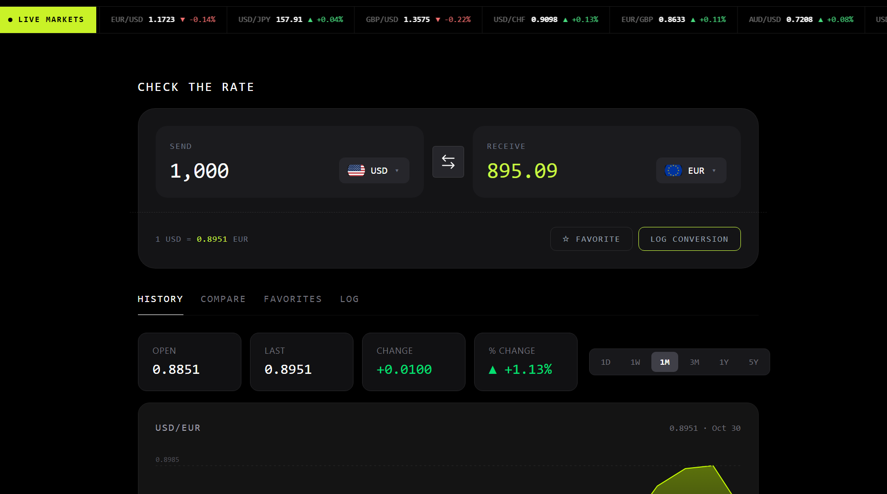

# Frontend Mentor - FX Checker solution

This is a solution to the [FX Checker challenge on Frontend Mentor](https://www.frontendmentor.io/challenges/foreign-exchange-currency-converter). Frontend Mentor challenges help you improve your coding skills by building realistic projects. 

## Table of contents

- [Overview](#overview)
 - [The challenge](#the-challenge)
 - [Screenshot](#screenshot)
 - [Links](#links)
- [My process](#my-process) 

 ## Overview

### The challenge

Your users should be able to:

### Converter

- Enter an amount to send and see it convert in real time as they type
- Pick the "send" and "receive" currencies from a searchable currency picker
- See the live exchange rate for the active pair (for example, `1 USD = 0.8530 EUR`)
- Swap the send and receive currencies with the swap button
- Favorite the active pair, and log a conversion to their history 

#### Currency picker

- Search the full list of available currencies by code or name
- See currencies grouped into "Popular" and "Other currencies", each row showing the flag, code, and name
- See a check against the currency that's currently selected

#### Live markets ticker

- See a ticker of currency pairs, each with its current rate and 24-hour change (up or down)

#### Rate history

- View a line and area chart of the active pair's rate over time
- Switch the chart range between 1D, 1W, 1M, 3M, 1Y, and 5Y
- See the open, last, absolute change, and percentage change for the selected range

#### Compare

- See their send amount converted into a range of other currencies at once, each with its reference rate
- Pin or unpin any comparison row to their favorites

#### Favorites

- See their pinned pairs, each with its live rate and 24-hour change
- Load a pinned pair back into the converter by selecting its row
- Unpin a pair they no longer want to track

#### Conversion log

- See a log of conversions they've made, each showing the relative time, the pair, and the send and receive amounts
- Clear the whole log
- Delete an individual entry

#### UI & accessibility

- View the optimal layout for the interface depending on their device's screen size
- See hover and focus states for all interactive elements on the page
- Navigate the entire app using only their keyboard 

### Screenshot

### Links
- Solution URL: ( https://www.frontendmentor.io/solutions/react-js-tailwindcss-vite-claude-kimi-chatgpt-ylTxmhrJ4U)
-Live Site URL: (https://foreign-exchaneg-checker.vercel.app/)

## My process

-React js
-TailwindCSS
-Vite Build tool

### What I learned

I familiarized myself with using react js and improve the manner at which i can use it in a real life project like this one, I also learned more about working with Application Programming Interface(API).

### AI Collaboration

- Tools I used ( ChatGPT, Claude, Kimi)
- Use them for (debugging, generating boilerplate, brainstorming solutions)

## Author

 Frontend Mentor - [@bigmanik](https://www.frontendmentor.io/profile/bigmanik)
- Twitter - [@bigmanik_igb](https://www.twitter.com/bigmanik_igb)
